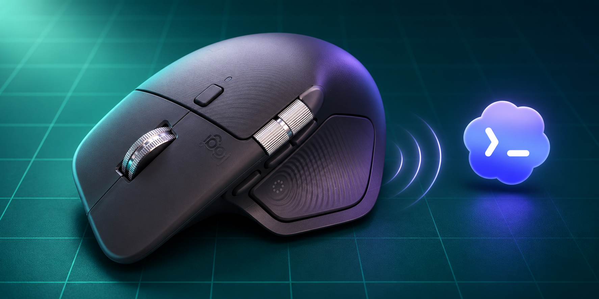

# CodexTouch



CodexTouch brings Codex notifications to the haptic motor in a Logitech MX
Master 4. A completed turn or a request for attention can give you a small
tactile signal. You and your agent can also play patterns deliberately.

This is an independent project, not an official OpenAI or Logitech product.

## What you need

- Windows and Python 3.11 or newer, with `pip` and the `py` launcher.
- A Logitech MX Master 4 with haptics enabled in its existing settings.
- A Codex version that supports command hooks and hook review.

The current hardware path targets VID `046D`, PID `B042`, usage page `FF43`,
usage `0202`, and HID++ feature `19B0`. It has been tested on Windows with
Python 3.13 x64 and one matching mouse. Other receiver modes, firmware versions,
and multiple matching devices may not work. CodexTouch will not choose between
multiple matching interfaces or change your mouse settings.

## Get started

Open PowerShell in the CodexTouch folder. Install the one dependency for your
Windows user, then check the mouse:

```powershell
py -3 -m pip install --user -r requirements.txt
py -3 codextouch.py inspect
```

No virtual environment is required. If you already use one, install the
dependency there and use that environment's Python for the commands below.
The user-level install above changes the `hidapi` package available to your
chosen Python interpreter.

To play a short test signal:

```powershell
py -3 codextouch.py play notification
```

`inspect` only queries the mouse; `play` triggers its haptic motor.

## Connect Codex

Preview the hook configuration first. When it looks right, apply it:

```powershell
py -3 configure_hooks.py
py -3 configure_hooks.py --apply
```

The installer keeps existing settings, notifications, and hooks, and saves a
backup before changing an existing configuration. It does not approve hooks for
you: review and enable them in **Codex Settings → Hooks** or with `/hooks` in
the CLI. Reload Codex if needed. If you already have haptic hooks, check for
duplicates before enabling these. [AGENT_SETUP.md](AGENT_SETUP.md) is a guide
for an agent helping with the setup.

The installer uses `CODEX_HOME/config.toml`, or `~/.codex/config.toml` by
default. The hooks use the Python interpreter that ran the installer. Keep this
folder at a stable path, and run the installer again if you move it or change
interpreters. `--target` selects a different configuration file.

## Signals and patterns

The defaults are:

| Event | Pattern |
| --- | --- |
| Completed Codex turn (`Stop`) | One `complete` signal |
| Permission request | Two short `attention` pulses |
| Supported user-input question | Two short `attention` pulses |

These depend on the events your Codex version emits. General desktop
notifications are not connected automatically; `event Notification` is
available for a separate notification source.

Try a few ready-made patterns without changing the event mappings:

```powershell
py -3 codextouch.py play double_click
py -3 codextouch.py play triple_click
py -3 codextouch.py play wave_then_click
```

The first two are two and three short clicks. The last plays the mouse's
built-in wave, then a short click. The wave's exact length and fade are set by
the device, so its feel can vary with the mouse and intensity setting.

Copy `config.example.json` to `config.json` to change event mappings or add
patterns. Set an event to `null` to mute it. `config.json` is local and ignored
by Git. Use `list` to see and validate the current configuration:

```powershell
py -3 codextouch.py list
py -3 codextouch.py play custom_example
py -3 codextouch.py sequence 4 5@300
py -3 codextouch.py --config examples\custom.json play double_pulse
```

A pattern has one to four steps in `WAVEFORM` or `WAVEFORM@DELAY_MS` form. The
delay comes before that step; each delay is at most 1,200 ms and all delays
together at most 1,500 ms. IDs are 0–31, and each waveform must be supported by
your mouse. CodexTouch checks the whole pattern before playing it. The mouse
controls waveform shape and intensity; arbitrary amplitude and duration are not
available.

## Privacy and operation

CodexTouch runs locally, opens no network port, and has no background service.
The `pip` install downloads the dependency from your configured package index.
Codex sends hook data on standard input; the script uses the event fields and
does not save or emit the supplied conversation text or tool arguments. A
missing mouse or an invalid configuration cannot block Codex through a valid
hook invocation.

This release only sends haptic signals **to** the mouse. It does not monitor
mouse buttons, send messages into chats, remap controls, or install autostart.
Separate haptic integrations may not share its device lock, so avoid running
two at once if signals become unreliable.

## Uninstall

Disable the hooks in Codex, or preview and apply removal:

```powershell
py -3 configure_hooks.py --remove
py -3 configure_hooks.py --remove --apply
```

Only the marked CodexTouch block is removed. The backup may contain other
private settings, so keep it private; do not restore it over newer changes
without comparing them first. You can then remove the project folder. The
user-installed `hidapi` package remains available to Python.

## Troubleshooting

- **No matching interface:** wake the mouse and check the hardware identifiers
  above. A different transport or receiver may expose a different interface.
- **Multiple matches:** disconnect the extra device and try again.
- **Missing `hid` module:** install the dependency with the same Python
  interpreter that runs CodexTouch and the hook installer.
- **Manual signal works, but hooks do not:** check hook review and enabled
  status, then test with a real Codex turn. A synthetic event alone does not
  prove your Codex version emits the hook.
- **Unsupported waveform or disabled haptics:** run `inspect` and use a
  supported waveform with haptics enabled in your mouse's own settings.

## Development

```powershell
py -3 -m unittest discover -s tests -v
```

See [VERIFICATION.md](VERIFICATION.md) for tested and untested paths.

## License

CodexTouch's code and documentation are available under the [MIT License](LICENSE).
The separately installed `hidapi` dependency has its own upstream licenses.
Codex and its depicted symbol belong to OpenAI; Logitech and MX Master belong
to Logitech. The project license does not grant rights to these third-party marks.
